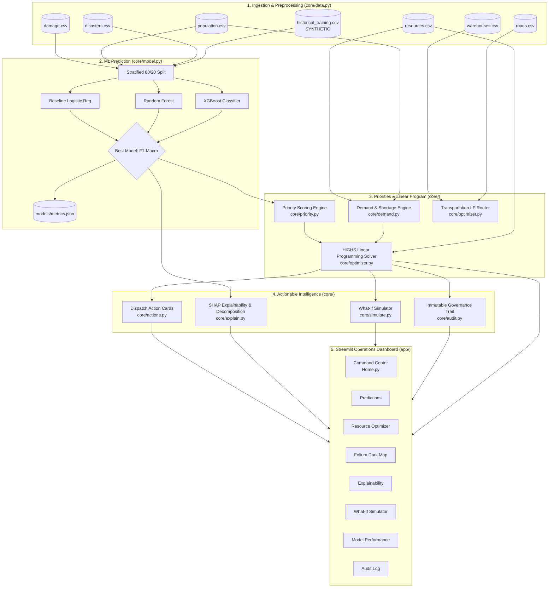

# 🚨 AI-Powered Emergency Resource Allocation & Decision Support System (ERAS)

[](https://www.python.org/)
[](https://opensource.org/licenses/MIT)
[](https://streamlit.io/)
[](https://scipy.org/)
[](https://docs.pytest.org/)

> **A decision-support system designed for emergency command operations.**  
> *The system supports human emergency managers; it never acts autonomously.*

---

## 📌 Executive Summary

During large-scale disasters (floods, earthquakes, hurricanes), emergency operations commanders must allocate scarce stockpiles (potable water, emergency rations, trauma kits) across disparate geographical sectors under severe time pressure. 

**ERAS** replaces ad-hoc spreadsheets with an end-to-end, mathematically rigorous decision support pipeline that moves from raw damage surveys to audited supply dispatches in milliseconds.


---

## 🏗️ System Architecture & Data Chain

Every number and metric on screen is strictly derived from verified mathematical routines, trained machine learning models, or the linear programming optimizer.



---

## 📂 Project Structure

```text
emergency-resource-allocation/
├── app/                                # Multi-page Streamlit Dashboard
│   ├── Home.py                         # 🚨 Command Center (KPIs, Scenarios, Action Cards)
│   └── pages/
│       ├── 1_Predictions.py            # 🔮 ML Damage Severity Predictions
│       ├── 2_Resource_Optimizer.py     # 📦 LP Allocations & Transportation Matrix
│       ├── 3_Map.py                    # 🗺️ Folium Interactive Map (Dark Tiles)
│       ├── 4_Explainability.py         # 🔍 SHAP Attributions & Score Decomposition
│       ├── 5_Simulator.py              # 🧪 What-If Parameter Stress Testing
│       ├── 6_Model_Performance.py      # 📈 Model Benchmark, CV Scores & Confusion Matrices
│       └── 7_Audit.py                  # 📜 Decision Trail Inspector & CSV Download
├── core/                               # Pure Business Logic (Decoupled from UI)
│   ├── __init__.py
│   ├── data.py                         # Ingestion, validation, preprocessing, synthetic data generator
│   ├── model.py                        # Model training, stratified 5-fold CV, metrics.json, selection
│   ├── priority.py                     # Priority score formula, normalization, risk thresholds
│   ├── demand.py                       # Sphere Project demand standards, shortage, coverage
│   ├── optimizer.py                    # SciPy HiGHS Linear Program & transportation LP
│   ├── actions.py                      # Action cards generator & dynamic operational warnings
│   ├── explain.py                      # SHAP TreeExplainer & priority score decomposition
│   ├── simulate.py                     # Full pipeline re-runner & Scenario A vs B comparator
│   └── audit.py                        # Immutable decision trail logger & history reader
├── data/                               # Tabular CSV Datasets
│   ├── damage.csv                      # Building damage counts per study area
│   ├── disasters.csv                   # Historical disaster event characteristics
│   ├── hospitals.csv                   # Hospital bed capacity & staffing
│   ├── population.csv                  # Population demographics & vulnerable counts
│   ├── resources.csv                   # Regional stockpiles by depot
│   ├── roads.csv                       # Road network corridors & damage states
│   ├── scenarios.csv                   # Pre-packaged disaster scenarios
│   ├── shelters.csv                    # Evacuation shelter capacities
│   ├── warehouses.csv                  # Logistics distribution depots
│   ├── historical_disaster_damage.csv  # Synthetic multi-scenario training dataset (800 rows)
│   └── audit_log.csv                   # Operational run execution history
├── models/                             # Serialized Models & Artifacts
│   ├── best_model.pkl                  # Chosen production model (XGBoost)
│   ├── damage_model.pkl                # Backwards-compatible model artifact
│   ├── label_encoder.pkl               # Target class label encoder
│   ├── shap_explainer.pkl              # Fitted SHAP TreeExplainer
│   └── metrics.json                    # Full quantitative benchmark & evaluation scores
├── tests/                              # Automated Pytest Test Suite
│   ├── test_priority.py                # Priority score bounds [0, 1] & determinism
│   ├── test_demand.py                  # Non-negativity, coverage bounds, manual calculator math
│   ├── test_optimizer.py               # LP bounds, zero-supply handling, transportation LP
│   ├── test_actions_and_explain.py     # Action cards matching LP, mandatory SHAP disclaimer
│   └── test_simulate_and_audit.py      # -30% water shock, reduction math, audit persistence
├── requirements.txt                    # Python package dependencies
└── README.md                           # System documentation & examiner demo script
```

---

## ⚡ Installation & Quickstart

### Prerequisites
- Python 3.10, 3.11, 3.12, or 3.13
- Git

### 1. Clone & Set Up Virtual Environment

```bash
# Clone the repository
git clone <repo-url>
cd emergency-resource-allocation

# Create virtual environment
python -m venv venv

# Activate virtual environment
# Windows (PowerShell):
.\venv\Scripts\Activate.ps1
# Linux / macOS:
source venv/bin/activate
```

### 2. Install Dependencies

```bash
pip install -r requirements.txt
```

### 3. Train Models & Verify Metrics

```bash
python core/model.py
```
*Output: Trains Baseline Logistic Regression, Random Forest, and XGBoost; runs 5-fold cross-validation; exports `models/metrics.json` and `models/shap_explainer.pkl`.*

### 4. Run Automated Test Suite

```bash
python -m pytest tests -v
```
*Output: 24 passed in ~4 seconds.*

### 5. Launch Operations Dashboard

```bash
streamlit run app/Home.py
```
Open your web browser at **`http://localhost:8501`**.

---

## 📐 Mathematical Formulation

### 1. Priority Scoring Engine
$$\text{Priority}_i = w_1 \cdot \text{norm}(\text{impact}_i) + w_2 \cdot \text{norm}(\text{demand}_i) + w_3 \cdot \text{norm}(\text{shortage}_i) + w_4 \cdot \text{norm}(\text{medical\_need}_i) + w_5 \cdot \text{norm}(\text{access\_penalty}_i)$$
- Features normalized via min-max scaling inside the active disaster scenario: $\text{norm}(x) = \frac{x - \min(x)}{\max(x) - \min(x)}$.
- Default weights: $w_1=0.25, w_2=0.25, w_3=0.20, w_4=0.15, w_5=0.15$.
- Classification cutoffs: `LOW` ($< 0.25$), `MEDIUM` ($[0.25, 0.50)$), `HIGH` ($[0.50, 0.75)$), `CRITICAL` ($\ge 0.75$).

### 2. Demand & Shortage Calculations
$$\text{Demand}_{ik} = \text{AffectedPopulation}_i \times \text{PerCapitaNeed}_k \times \text{Duration}$$
$$\text{Shortage}_{ik} = \max(0, \text{Demand}_{ik} - \text{Allocated}_{ik}), \quad \text{Coverage}_k = \min\left(1.0, \frac{\text{Total Available}_k}{\text{Total Demand}_k}\right)$$

### 3. Linear Programming Allocation (LP)
$$\max \sum_{i=1}^N \sum_{k} \left( \text{PriorityWeight}_i \times \frac{x_{ik}}{\text{Demand}_{ik}} \right)$$
$$\text{Subject to: } \sum_{i=1}^N x_{ik} \le \text{Supply}_k \quad \forall k, \quad 0 \le x_{ik} \le \text{Demand}_{ik} \quad \forall i, k$$
- Solved with `scipy.optimize.linprog` using the modern `highs` dual-simplex/interior-point solver.
- Status is strictly called **`OPTIMAL`** only when verified by the solver return code (`status == 0`).

---

## ⚠️ Transparent Limitations & Assumptions

In accordance with responsible AI standards and the project charter:

1. **Synthetic Data Disclosure**: All 9 raw CSV files are **SYNTHETIC** data based on standard schemas (EM-DAT, WorldPop, xBD, OSM). Real geographic coordinates are used for Houston, Texas nodes, but damage survey numbers and population attributes are simulated.
2. **Per-Capita Standards are Assumptions**: Daily consumption rates (Water: 3.0 L/day, Food: 2.0 packs/day, Medical: 0.05 kits/day) are labelled **ASSUMPTION** in the UI and must be adjusted by mission planners based on weather and field logistics.
3. **Weights and Thresholds are Assumptions**: The priority weighting vector ($w_1..w_5$) and risk tiers represent operational policy assumptions and can be altered in real-time via sidebar sliders.
4. **Unavailable Features**:
   - **No Live Fleet Telemetry**: Live GPS vehicle convoy tracking is currently unavailable.
   - **No Real-Time Sensor Streams**: No continuous hourly rainfall gauge or seismic sensor time-series streams exist.
5. **No Causation in SHAP**: Feature attributions describe model predictive associations, not physical causality.
6. **No Autonomous Dispatch**: System provides decision-support intelligence only; final operational authority rests strictly with human emergency commanders.

---

## 🎬 5-to-7 Minute Examiner Demonstration Script

Follow this step-by-step narrative to demonstrate the complete system during an evaluation or course presentation:

### Minute 1: Introduction & Command Center Overview
1. Open the dashboard at `http://localhost:8501` on **Command Center**.
2. Point out the **Key Performance Indicators (KPIs)**:
   - *"Notice our live KPIs: Total affected population, critical area count, available stockpile, and residual shortage."*
   - Hover over the help tooltip on **Shortage Cut vs Base** to explain the baseline comparison.
3. Point out the sidebar:
   - *"All subjective policy parameters—such as per-capita water standards and priority weights—are clearly tagged as **[ASSUMPTION]** and can be adjusted live."*

### Minute 2: Executing AI Analysis
1. Select the **Flood** scenario.
2. Click **⚡ RUN AI ANALYSIS**.
3. Point out the **Dynamic Operational Alerts**:
   - Show how the system flags transit bottlenecks (e.g., blocked roads) and regional water deficits.
4. Show the **Top Recommended Action Cards**:
   - *"These action cards are auto-generated from the LP optimizer. Notice they quote real numbers—such as exact population, damaged structures, and exact liters to dispatch."*

### Minute 3: Spatial & Prediction Inspection
1. Navigate to **Predictions**:
   - Show the breakdown of predicted severity across areas.
   - Show the structural survey table (destroyed vs major vs minor).
2. Navigate to **Map**:
   - Show the Houston study area with dark CartoDB tiles.
   - Highlight the risk-colored circle markers (Red = Critical, Orange = High, Yellow = Medium).
   - Point out the warehouse depots (Blue), hospitals (Purple), and blocked road corridors (Red dashed lines).
   - Click or select **Area C** to show the area inspection card.

### Minute 4: Explainability (SHAP & Priority Decomposition)
1. Navigate to **Explainability**:
2. Show the **Global Feature Importance** bar chart:
   - *"The XGBoost model relies most heavily on destroyed buildings, building damage, and magnitude."*
3. Select **Area C** in the Local Explanation section:
   - Read the generated natural language narrative quoting the exact feature values.
   - Point out the mandatory disclaimer:
     > *"Contributions describe model behaviour, not causation."*
4. Scroll to **Priority Score Decomposition**:
   - Show how Area C's priority score is mathematically decomposed into Structural Impact, Demand, Shortage, Medical Need, and Access Penalty.

### Minute 5: Resource Optimization & Baseline Impact
1. Navigate to **Resource Optimizer**:
2. Show the **Solver Status** indicators showing **`OPTIMAL`**.
3. Highlight the **Optimization Impact vs Baseline** section:
   - *"Notice the quantitative comparison: our LP optimizer achieves a net shortage reduction compared to an equal-share population baseline, proving real mathematical efficiency."*
4. Show the stacked bar chart of **Allocated Supply vs Remaining Shortage**.
5. Scroll down to show the **Transportation LP Matrix** routing supplies from Depot W1 and W2.

### Minute 6: What-If Stress Testing Simulation
1. Navigate to **Simulator**:
2. Explain the scenario: *"What happens if floodwaters contaminate our primary water reservoir, cutting water availability by 30%?"*
3. Set the **Water Supply Shock** slider to **-30%**.
4. Click **🚀 EXECUTE WHAT-IF SIMULATION**.
5. Show the before-vs-after comparison table:
   - Show the immediate jump in water shortage and the drop in regional coverage.
   - Show the area-by-area dispatch delta table demonstrating how the LP optimizer prioritized high-risk sectors while rationing low-risk sectors.

### Minute 7: Governance Audit Log & Q&A Conclusion
1. Navigate to **Audit**:
2. Show the persistent decision log:
   - *"Every analysis we just performed is logged immutably with a UTC timestamp, model name, scenario inputs, solver status, and exact dispatches."*
3. Click **📥 Download Complete Audit Trail (CSV)** to show compliance readiness.
4. Conclude:
   - *"In summary, ERAS creates a transparent, auditable bridge from raw disaster data to optimized life-saving logistics."*

---

## ❓ Frequently Asked Questions (Examiner Cheatsheet)

| Question | Answer & Source |
| :--- | :--- |
| **Why did you choose this ML model?** | In [models/metrics.json](file:///d:/Disaster/emergency-resource-allocation/models/metrics.json), we benchmarked three models using stratified train/test split and 5-fold CV. **XGBoost** achieved the highest $F_1$-Macro score (**0.7366**) and test accuracy (**81.87%**), outperforming both the Logistic Regression baseline ($F_1 = 0.6765$) and Random Forest ($F_1 = 0.7183$). |
| **How does the optimizer work?** | Formulated as a Linear Program (LP) in [core/optimizer.py](file:///d:/Disaster/emergency-resource-allocation/core/optimizer.py). It maximizes priority-weighted demand satisfaction $\sum p_i \frac{x_i}{D_i}$ subject to $\sum x_i \le \text{Supply}$ and $x_i \le D_i$, solved using the SciPy HiGHS solver. |
| **What does SHAP show?** | SHAP values quantify the additive contribution of each survey feature toward moving the model's prediction toward or away from a given severity class. It describes model behavior, **not physical causation**. |
| **Which numbers are assumptions?** | All per-capita consumption standards (Water: 3.0 L/day, Food: 2.0 rations/day, Medical: 0.05 kits/day), mission duration (3.0 days), and the priority weight vector ($w_1..w_5$) are explicit assumptions labelled `[Assumption]` in the UI. |
| **What data is synthetic?** | All CSV tabular records in `data/` were generated synthetically to emulate EM-DAT, WorldPop, xBD, and OSM schemas. Real coordinates for Houston, TX are used, but disaster impacts are synthetic. |
| **What happens if supply is zero?** | Handled gracefully in [core/optimizer.py](file:///d:/Disaster/emergency-resource-allocation/core/optimizer.py) without solver failure; reports status `"ZERO_SUPPLY"` and allocates 0 units. |

---

## 📜 License & Acknowledgements

Developed as a college Python course capstone project implementing state-of-the-art decision support engineering, mathematical programming, and transparent machine learning. Distributed under the MIT License.
